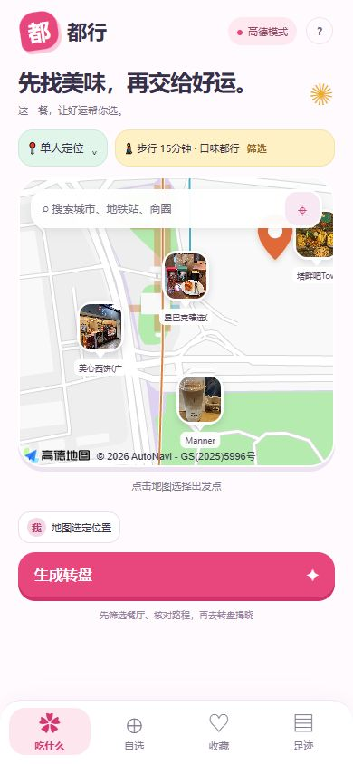
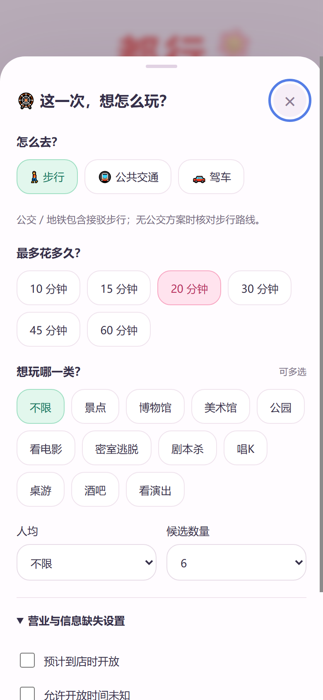
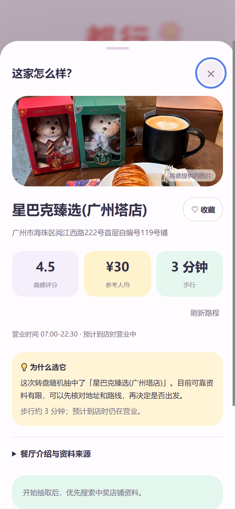

# 都行 · Douxing

> 把纠结，交给一点好运。

美食、游玩、旅行三合一的随机决策原型：选好条件和出发点，用等概率转盘替你拍板，再用高德地图核对真实路程，用 DeepSeek 联网检索整理门店 / 场馆的公开资料。转盘结果下方是**站内用户写的真实评价**（星级、文字、图片、标签、点赞），按大众点评的方式排布。手机竖屏优先，纯原生 HTML / CSS / JavaScript，无需构建、无框架依赖。

> 这是个人学习与原型验证项目，**不是**生产级应用；评分、营业时段、路线均为查询时的第三方数据，请以前往时的实际情况为准。

<p align="center">
  
  
  
  
</p>

## 功能

### 吃什么

- 地图选点或搜索地点，按步行 / 公交地铁 / 驾车时间、菜系、人均、是否营业筛选附近餐厅。
- 菜系支持中餐、西餐、韩餐、日料、火锅、东南亚、烧烤、奶茶；分类按高德类型码检索，关键词类菜系按名称二次匹配。
- 评分、人均、营业时段读取高德 POI 数据（JS API 2.0 的顶层字段），缺失时明确显示「高德未提供」，不编造。
- 营业时段会解析 `opentime2` / `open_time` 的星期规则与特殊日期，按「现在 + 最长路程」估算到店时是否营业。
- 等概率转盘抽取、本轮不重复、排除与快速调整；结果页展示真实商户图、路线、营业时间与收藏 / 分享。
- 中奖后由 DeepSeek 检索公开资料，整理介绍、评价摘要与「为什么选它」解读，并给出可核对的来源链接。

### 去哪玩

- 景点类：景点、博物馆（含展览馆 / 蜡像馆 / 临展）、美术馆、公园。
- 娱乐类：看电影、密室逃脱、剧本杀、唱K、桌游、酒吧、看演出。
- 与美食共用同一套能力：真实路线、人均筛选、预计到店时开放筛选（可允许开放时间未知）、等概率转盘、收藏与 AI 资料；支持单人 / 2～6 人多人同玩。
- 同一景区的多个子点位（如广州塔 A 区 / 登塔大厅 / 观景平台）会合并成一个候选，不同场馆不会被合并。
- 价格显示：景区没有门票价时显示「门票以景区为准」，娱乐场馆按高德返回的人均值显示；游玩不设「价格未知」开关，未知价格不参与人均筛选。
- 按高德类型码检索 + 名称校验，结果带场馆表情与真实路线；支持「在高德查找场馆」加入自选。

### 想旅游

- 24 座国内城市的候选转盘，支持日期、天数、人均预算、出行方式、兴趣、同行与亲子条件。
- 抽中城市后生成可编辑的分日行程（替换 / 删除景点、加入必去、放轻松），支持地图展示、保存、草稿恢复与分享卡片。
- 联网介绍只发送公开城市 / 地点名称，不发送出发城市、日期、预算或同行信息。

### 用户评价

- 转盘抽中后，结果页下方展示这家店的**本站用户评价**：平均分、五星分布直方图、标签云、图片墙，按「最有帮助 / 最新 / 最低分 / 最高分」排序，可点标签筛选、可「加载更多」。
- 餐厅 / 场馆结果页先「加入行程」，在个人资料的「我的足迹」中显示为「待出发」；加入时不生成到访记录或评分，同一地点的待出发行程不重复添加。
- 实际体验后，在待出发行程点击「确认到访并评价」，可打 1～5 星、选最多 4 个标签、写 5～600 字、上传最多 3 张图片；保存后转为「已到访」。图片在浏览器里先压缩再上传，名称与头像取自个人资料，表单不再单独填写昵称。
- 进入确认到访、补录或编辑足迹表单后，直接显示到访日期、人均与备注，无需重复勾选到访。备注和人均均可留空；勾选发布评价后，填写的实际人均会显示在公开评价中，到访日期与备注不公开。
- 已到访记录与结果页展示同一份个人五星评分；可以多次记录到访，日期、花费和私密备注各自保留。原有「喜欢／一般／不喜欢」保留为历史感受，不自动换算星级。
- 评分、文字和图片默认仅保存在本机；明确勾选「同时发布到站内」后才公开。每台设备对同一家店保留一条可修改的公开评价；修改后更新原评价及站内平均分，保留点赞与原发布时间。
- 「有用」可以再点一次取消；公开评价存在本地服务的 `data/` 目录，重启后仍在。个人评分、高德评分和站内平均分分别标注。
- 评价区**没有任何内置或伪造数据**：没人写过就显示「还没有人评价过这里」。演示 / 自选门店的评价会额外标注来源，避免和真实门店混淆。

### 其他

- 自定义转盘：从首页“自定义”卡片进入，支持输入文字、地图选地点、从收藏添加，2～20 个选项可混合抽取；真实地点保留介绍、收藏与路线。底部导航不再单独设置“自选”。
- 收藏、到店 / 游玩 / 旅游足迹、分享卡片（本地生成 PNG，不上传服务器）。
- 多人起点：最多 6 位同行者，分别设置出发点、出行方式与时间上限，优先满足所有人可达（美食模式）。
- 浏览器返回 / 前进：先退出当前弹层，再退回上一页或上一步；保留本次页面会话中的自定义输入、旅行条件和未提交记录。取消转动或生成后，旧请求不会重新弹出结果。
- 转盘先匀速转动，再从当前速度连续减速，慢慢停在中奖选项上；支持系统的减少动态效果设置。
- 弹窗关闭按钮固定在上方，内容独立滚动；浏览器返回 / 前进会恢复弹窗的滚动位置。

## 运行

要求 **Node.js 20+**（开发时使用 Node.js 22），无需 `npm install`。

```bash
# 方式一：Windows 双击
启动原型.cmd

# 方式二：命令行
node server.cjs
```

打开 http://127.0.0.1:5173 。服务默认只监听本机 `127.0.0.1`，手机实机访问需要自行做 HTTPS 部署。

想让自己以外的人也能写评价，可以显式监听局域网（同一 WiFi 下的设备访问 `http://你的内网IP:5173`）：

```bash
HOST=0.0.0.0 node server.cjs        # Windows PowerShell: $env:HOST='0.0.0.0'; node server.cjs
```

>`HOST` 一旦放开，Host 校验也会放开；服务没有账号体系，**只建议在可信局域网内临时这样跑**，不要直接暴露到公网。

### 配置

本仓库是**私有验证仓库**，按维护者要求已提交真实的 `.env`（高德 JS API Key + 安全密钥、DeepSeek Key）。如果你拿到的是公开副本或准备公开仓库，请先轮换密钥并删除 `.env`，只保留 `.env.example`。

```dotenv
AMAP_JS_KEY=你的 Web端（JS API）Key
AMAP_SECURITY_CODE=该 Key 的安全密钥
DEEPSEEK_API_KEY=你的 DeepSeek Key
DEEPSEEK_MODEL=deepseek-flash
```

- 高德 Key 需要 **Web端（JS API）** 类型，控制台如有域名白名单，请加入 `127.0.0.1` / `localhost`。
- 安全密钥只在本地 Node 服务使用，通过 `/_AMapService` 代理附加，不会下发到浏览器。
- 未配置 Key 时自动进入演示模式，使用明确标注的虚构数据。

## 目录结构

```text
demo/
├─ index.html            页面骨架（原生多文件脚本）
├─ server.cjs            本地服务：静态白名单、配置接口、高德安全代理、AI 接口
├─ core.js               演示模式数据模型（评分、营业时段、路线估算）
├─ amap-client.js        高德 JS API 适配：搜索、类型码分类、营业时段解析、路线、详情
├─ map-ui.js             地图首页与真实模式候选生成、详情 / 路线补取
├─ app.js                主界面、转盘、自选、收藏、足迹、结果弹层
├─ wheel-motion.js       三类转盘共用的匀速与连续减速动画
├─ app-history.js        页面 / 弹层历史、返回取消与会话编辑草稿
├─ discovery.js          地图首页、照片图钉与分步页面
├─ freewheel.js          自定义转盘
├─ travel-core.js        旅行候选、地点匹配与行程模型
├─ travel.js             旅行页面、异步资料、地图、存储与分享
├─ ai-client.js          前端 AI 资料请求
├─ ai-service.cjs        服务端 DeepSeek 搜索 + Chat 整理
├─ reviews.js            结果页评价区：星级分布、标签、排序、点赞、写评价与图片压缩
├─ reviews.cjs           服务端评价存储：校验、去重、点赞、图片落盘（data/）
├─ review-model.js       我的五星评价与到访记录关联、本机保存与失败回滚
├─ data/                 运行时生成：reviews.json 与 uploads/ 图片（已 gitignore）
├─ style.css             全部样式（手机竖屏优先，320px 起适配）
├─ assets/               首页与自定义页卡通插画
├─ screenshots/          验证截图
├─ test.cjs              核心逻辑测试（18 项）
├─ map-test.cjs          高德适配 / 去重 / 代理 / 竞态测试（43 项）
├─ ai-test.cjs           AI 链路测试（21 项）
├─ travel-test.cjs       旅行链路测试（13 项）
├─ review-test.cjs       评价链路测试（19 项：校验、编辑权限、人均、排序、点赞、图片、HTTP）
├─ review-model-test.cjs 统一评分、行程状态、旧足迹保留与保存回滚（9 项）
├─ 启动原型.cmd           Windows 启动脚本
├─ 高德接入说明.md        高德 Key 申请、配置与已知边界
└─ 验证记录.md            分阶段实网验证与测试记录
```

## 技术实现

- **前端**：纯原生 HTML / CSS / JavaScript，无框架、无打包步骤；多文件脚本按功能拆分。转盘、地图覆盖物均为内联 SVG。
- **本地服务**：`node:http` 实现静态文件白名单（只暴露页面所需文件）、`/api/map-config`、`/api/ai-config`、`/api/store-research`、`/api/option-research`、`/api/reviews`（GET 列表 / POST 发布 / PUT 修改本人评价）、`/api/reviews/like`、`/uploads/*`（评价图片），以及 `/_AMapService` 高德安全代理（固定上游、覆盖伪造参数、隐藏安全密钥、拒绝非法回调）。
- **高德地图**：JS API 2.0 插件（PlaceSearch / Geocoder / Geolocation / Walking / Driving / Transfer）。JS API 2.0 把 `rating`、`cost`、`open_time` 放在 POI 顶层；分类按类型码检索，路线请求串行节流并缓存 5 分钟。
- **去重与价格语义**：景点类按名称包含 / 名称前缀 / 地址中的地标名做 300 米内聚类（并查集合并），保留评分最高、资料最全的一个；景点门票未知时显示「门票以景区为准」，不参与人均排除。
- **AI**：DeepSeek Search API + Chat Completions，先搜公开摘要；真实门店 / 场馆先审核来源是否直接相关，再整理 JSON，排除名单中顺带提及、无关地点等来源。介绍与评价分开展示，缺少评价时显示「暂无相关评价」。保留中奖优先、15 分钟缓存、超时降级、来源逐字校验，不编造评分 / 图片 / 链接。
- **用户评价**：`reviews.cjs` 把评价写进 `data/reviews.json`（先写临时文件再 rename，存档损坏时改名保留），图片与头像按 `<评价ID>-<序号>.jpg` 落在 `data/uploads/`；服务端校验星级、字数、标签白名单、图片真实格式与体积，按「设备 + 门店」去重，按 IP 限流（30 条 / 小时），点赞按设备去重；前端只负责展示、压缩与转义。
- **隐私**：DeepSeek 只收到公开店名、分店地址、城市、分类；个人起点、路线坐标、收藏与足迹仅保存在本机浏览器。

## 测试

```bash
node test.cjs
node --test map-test.cjs
node --test ai-test.cjs
node --test travel-test.cjs
node --test ui-test.cjs
node --test review-test.cjs
node --test review-model-test.cjs
```

已有 Playwright 和 Chromium 的环境还可运行 `node browser-test.cjs`，验证返回 / 前进、嵌套弹层、未提交表单和实际动画。`DOUX_TEST_CHROMIUM` 可指定已有 Chromium 路径；无需给原型安装运行依赖。

首页插画使用 512px WebP，四张合计约 157 KiB；插画缓存一小时，HTML / JavaScript / CSS 使用内容 ETag 重新校验，API 与高德代理仍使用 `no-store`。

地图 / AI / 旅行 / 评价测试使用模拟响应与临时目录（评价测试不会写进 `data/`），与 `验证记录.md` 中的实网验证分开记录；实网验证使用本机配置，结论仅代表当时的样本。

## 已知边界

- 高德 POI 接口**不返回评价正文**，只有评分、人均、营业时段、电话、图片等字段；界面的「评价摘要」来自 DeepSeek 联网检索的搜索摘要，不是完整评论，检索不到同一分店时明确显示暂无资料。
- 评分 / 人均 / 营业时段可能部分缺失（不同门店覆盖不一）；无法解析营业时段的门店在严格营业筛选下会被排除，可勾选「允许营业时间未知」。
- 同一景区的多个子点位（如广州塔的 A 区、登塔大厅、观景平台）会按名称与地址合并成一个候选；不同场馆不会被合并，美术馆等小众分类的覆盖依赖高德数据，数量可能很少。
- 游玩已对齐美食的路线 / 人均 / 开放筛选与多人起点，但暂不做电影、演出场次筛选与到店用餐记录；餐厅与场馆均非全城穷举，只比较本次已核对的有限候选。
- 旅游模块的车票 / 酒店价格、跨城交通、天气、门票与预约未接入实时查询；行程是可编辑草案。
- 高德 / DeepSeek 的额度、权限与收费标准以各自控制台为准，项目不自动开通付费服务。
- 用户评价是**本站用户写的**，不是大众点评 / 美团的数据；没有账号与实名，昵称可以随意填写，无法验证评价者是否真的到过店，也没有商家回复与申诉。
- 评价只存在运行服务的这台机器（`data/`），没有云端同步；换机器、删目录或重装都会丢失。单人自测时看不到「别人的评价」，需要真的有人访问同一台服务才会出现。
- 评价图片在浏览器端压缩到长边 1200px、单张约 300KB 以内，服务端再限制单张 400KB、总计 900KB、最多 3 张；上传的图片不会被二次审核，请自行判断内容是否可靠。

## 安全与隐私

- 仓库为私有，按维护者要求包含真实 `.env`；**如需公开，请先轮换全部密钥并移除 `.env`**。
- 本地服务仅监听 `127.0.0.1`，拒绝跨站请求，静态文件按白名单返回，`.env`、`.git`、服务端源码不可下载；打包脚本同样排除密钥。
- 收藏、足迹、旅行草稿只存在当前浏览器；清除站点数据会删除。
- 评价（昵称、头像、文字、图片）会公开显示给访问本站的所有人；头像只保留 96×96 的压缩版本，设备标识只保存哈希（用于「一家店只能评一次」和点赞去重），不保存原始浏览器 ID。
- 评价数据落在 `data/`，已加入 `.gitignore`，不会被误提交；公开部署前请先确认你接受这些内容公开。
- 高德设备定位仅在主动点击「定位」时请求。

## 文档

- [高德接入说明.md](高德接入说明.md)：Key 申请、配置、体验流程与已知边界
- [验证记录.md](验证记录.md)：分阶段实网验证、截图与测试记录

---

个人学习项目，未指定开源许可证；如需复用其中代码或素材，请先联系仓库维护者。
